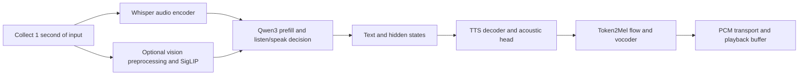

# MiniCPM-o 4.5 inference: bottlenecks and optimization decisions

This records the earlier optimization round. The subsequent
[voice-path report](voice-optimization-rtx3060.md) adds measured lazy vision
loading and an interleaved AVX2 acoustic head to the NVIDIA profile.

Measured on this host on **2026-11-14**: RTX 3060 12 GB, SM 8.6, i7-10700F
(8 cores / 16 threads), 32 GB RAM, native Windows/WDDM, CUDA 12.8.1, driver
610.88. The starting point already included the optimizations in
[the earlier measurement report](performance-rtx3060.md). The gains below are
incremental to that working tree, not to unmodified upstream.

The NVIDIA profile enables host placement of unused TTS tables, compact audio
workspace reservation and faster exact bicubic resizing. The new CUDA acoustic
head and audio Flash Attention remain **experimental and disabled**. The
selected changes retain Q4_K_M LLM weights, F16 acoustic weights and KV,
4096-token contexts, the existing vision attention setting, speech sampling,
25-token acoustic windows plus lookahead, and flow/vocoder steps. Exactness is
checked against recordings from fresh processes with matching seeds and input
history. It establishes equivalence for those recordings, not subjective quality
acceptance for every voice or conversation.

## Where time and memory go



Audio and vision encoding already run concurrently. The audio/video baseline's
median vision time was **160–165 ms**, versus roughly **14 ms** for audio. The
vision measurement includes image decoding/preprocessing; it is not just GPU
matrix multiplication. Removing 30 ms from an overlapped 14 ms audio stage
cannot remove 30 ms from this critical path. Speech generation and Token2Wav
continue asynchronously after the input response.

The native protocol's `generate_ms` / `cost_llm_ms` also include waiting for
the duplex encoder; do not add them to `encoder_ms` as independent stage costs.
The replay starts its latency clock when a complete input chunk is sent. It
does not include microphone collection, acoustic endpointing, network jitter,
browser AEC, or speaker playback.

Tensor payload inventory, read from the actual local GGUF files:

| Component | Tensor payload MiB | Consequence |
| --- | ---: | --- |
| Q4_K_M LLM, 8,189,195,264 parameters | 4788.17 | Main single-token decode bandwidth cost |
| Vision encoder/resampler | 1044.36 | Dominant audio/video encoder time |
| Audio encoder/projector | 629.50 | Small streaming compute, oversized initial workspace |
| TTS GGUF, including extra tensors | 1097.82 | Not all tensors need a GPU copy |
| Token2Mel encoder + flow + extra | 594.33 | Mostly original F32 weights |
| Vocoder | 79.37 | Small weights; many sequential kernels |
| Token2Mel prompt cache | 201.81 | Includes 188.75 MiB estimator attention cache |

These are file tensor bytes, **not additive GPU allocations**. Some tensors are
on CPU, some are duplicated, and workspace, runtime caches, CUDA graphs and the
desktop also consume VRAM. At 4096 tokens, the model dimensions imply these
F16 K+V payloads, before allocator overhead:

| Cache | Calculation | MiB |
| --- | --- | ---: |
| LLM | 2 × 36 layers × 4096 × 8 KV heads × 128 × 2 bytes | 576 |
| TTS | 2 × 20 layers × 4096 × 12 heads × 64 × 2 bytes | 240 |
| Streaming audio | 2 × 24 layers × 1500 × 1024 × 2 bytes | 140.63 |

The previous isolated LLM result was about **63 tokens/s**. For perspective,
streaming approximately 4.67 GB of decoder weights per token at the RTX 3060's
nominal 360 GB/s gives an idealized bandwidth ceiling near 77 tokens/s. This is
a rough roofline, assuming no other work, no overhead and no cache effects;
it is not an achieved or guaranteed rate. More CPU threads, Tensor Core peak
FLOPS, or additional workers cannot by themselves multiply this decode rate.
The 4.67 GB figure is decimal: 4671134848 tensor bytes, excluding the
349627392-byte input embedding table that is accessed by row.

## Implemented and measured

1. **Keep unused TTS text tables off CUDA.** With hidden-only TTS enabled,
   `OMNI_TTS_TOKEN_EMBD_CPU=1` places the tied 158626 × 768 text token/output
   table on CPU using the existing tensor placement API. Its GPU payload is
   232.36 MiB. Native TTS still uses the original embeddings, acoustic head and
   F16 decoder. Requesting text logits bypasses this optimization.
2. **Gather TTS conditioning rows on CPU.** `OMNI_TTS_HOST_EMBED=1` uploads only
   requested F32 rows from the already resident host table, keeping projection,
   normalization and addition on CUDA. This avoids the separate **445.50 MiB**
   `emb_text` GPU table when the ordinary-chat conditioning graph initializes.
   That table was not allocated by the pure duplex baseline, so this saving
   must not be added to the duplex VRAM result below.
3. **Reserve for streaming audio.** `OMNI_AUDIO_RESERVE_FRAMES=100` reserves a
   one-second mel query against the full existing audio history instead of a
   3000-frame query. The same allocator can still grow for longer inputs. Cache
   contents, history length and positions are preserved. After a longer input,
   the enlarged workspace may remain allocated.
4. **Remove overwritten resize work.** `OMNI_VISION_FAST_RESIZE=1` computes the
   final vertical bicubic interpolation once, caches identical clipped source
   coordinates, and splits output rows over `OMNI_VISION_RESIZE_THREADS=4`
   threads. It keeps the original coefficients, arithmetic and rounded pixels.
   On the first real image, decode + preprocess fell from **46.25 to 8.91 ms**;
   overview plus slices fell from **52.25 to 16.53 ms**. Eight source images
   cover real frames, random pixels, 1×1, odd dimensions, panorama and portrait
   layouts. All ten tested layouts preserved normalized pixel bytes; encoded
   single/sliced real-image embeddings were also byte-identical.
5. **Experimental CUDA acoustic projection, disabled.** `OMNI_TTS_CUDA_HEAD=1` keeps
   19.23 MiB of F32 weights in a layout that coalesces adjacent output lanes.
   Each thread accumulates one output in the original ascending hidden order
   with explicitly rounded multiply and add instructions. There is no FMA,
   tree reduction, weight quantization, sampling change or extra flow shortcut.
   Reused device buffers, pinned staging and a nonblocking stream handle the
   768-float input and 6562-float output. Failure falls back to the CPU head;
   the selected CPU AVX2 fallback remains available.

The acoustic-head hardware test checks **100 × 6562 logits per process** against
AVX2, including the final partial output group. Three initial real-weight runs:

| Run | AVX2 ms | CUDA ms, including transfers | Speedup |
| --- | ---: | ---: | ---: |
| 1 | 0.8601 | 0.1282 | 6.71× |
| 2 | 0.7958 | 0.1243 | 6.41× |
| 3 | 0.7869 | 0.1215 | 6.48× |

All logits were byte-identical. A subsequent three-run check measured CUDA
0.1227–0.1616 ms and also passed. This is a local operator speedup, not a 6×
pipeline speedup. Synthetic weights also pass.

The isolated test is insufficient for enabling it: at TTS temperature 0.8, the
first duplex session matched the baseline PCM, but the second session diverged
starting at sample 213120 despite matching text and sample counts. Two original
baseline processes and the new binary with the CUDA head disabled reproduced
the same second-session PCM. The cause has not been localized to projection,
upstream decoding or asynchronous synthesis. **Keep `OMNI_TTS_CUDA_HEAD=0` and
AVX2 as the profile default** until full-pipeline sampled-speech equivalence or
an explicitly accepted quality tradeoff is established.

The audio reservation test encoded 36 consecutive one-second chunks, one
30-second input, and another short chunk. All **2,744,320 F32 values** matched
the baseline byte-for-byte; concatenated SHA256:
`18550d717e4eefafd2c4a9fa6e9b5d121f3a607ba74fb469627a68e080629f93`.

Full native replay, 36 one-second audio/video inputs per round, two rounds per
fresh process, LLM greedy, TTS temperature 0, sampler seed 42:

| Variant / round | Input p50 ms | p95 ms | First SPEAK input → PCM ms |
| --- | ---: | ---: | ---: |
| Previous working tree / 1 | 236.77 | 339.26 | 568.01 |
| Selected profile, AVX2 head / 1 | 207.92 | 308.27 | 539.79 |
| Previous working tree / 2 | 233.54 | 332.27 | 506.62 |
| Selected profile, AVX2 head / 2 | 207.97 | 309.52 | 481.78 |

Median input processing fell **12.2% / 10.9%**, p95 fell **9.1% / 6.8%**, and
first PCM arrived **28.22 / 24.84 ms** earlier. Whole-card peak, sampled every
200 ms, was **10921 → 10408 MiB**, a 513 MiB reduction. It includes the desktop
and other processes, is not an exact process allocation measurement, and may
miss shorter peaks. A memory-only trial measured 10428 MiB with essentially
unchanged latency; the speed changes were evaluated separately afterward.

The experimental CUDA-head combination measured p50 207.98 / 201.09 ms, p95
305.06 / 301.16 ms and sampled peak 10296 MiB. These are separate sequential
trials with desktop VRAM variation; they do not establish that adding the
19.23 MiB CUDA head reduces VRAM. Its sampled-speech issue excludes it from
the selected profile.

Both corresponding rounds preserved **all text and PCM bytes**: 270720 / 274560
samples (11.28 / 11.44 s), finite and unclipped. PCM SHA256:

- Round 1: `1e0814ad007f6efe168c33b4bf9e283ee4520a41d463914b8981741772641b7c`
- Round 2: `54f52c23df47fbe1dfa9a19fd8639d8368c092e778a75aef750700e22650250c`

Evidence is local in `verification/optimization-v3/{baseline,memory,fast,selected}/`,
`resize*.json`, `audio-*.f32`, and `cuda-head.log`. Two rounds from sequential
processes do not establish a universal improvement or confidence interval.

### Actual sampling, ordinary chat and sustained use

With the selected profile and TTS temperature **0.8**, two successive audio-only
sessions preserve baseline text and PCM bytes: 529920 / 533760 samples, 22.08 /
22.24 seconds, finite and unclipped. The original binary reproduced these hashes
in a second fresh process as well:

- Session 1: `afc1b819ec45b682fc44e26c1154d6f36b7e454789be68329f8595a5c09b6bde`
- Session 2: `d7ea657ba450e5b7afc4e7618d8fccd72752fae5f8f525805d416db6590fc0e8`

Audio-only p50 was roughly 155–162 ms, with overlapping/noisy tail measurements
across variants; **no stable voice-only latency gain is demonstrated**. The
substantial processing gain above concerns audio/video inputs. Memory savings
also apply to audio-only sessions.

Ordinary-chat A/B used two Chinese greedy-speech requests and one English
request at acoustic temperature 0.8. Text and sample counts match. One original
baseline run has different PCM; another original baseline run matches all three
selected-profile hashes. This is pre-existing process-level variability, so a
seed alone is insufficient evidence of bitwise chat determinism. An isolated
real-weight conditioning probe compares **122112 F32 outputs** at token counts
1, 10, 40, 2, 96 and 10, including vocabulary boundaries: host gather and GPU
lookup are byte-identical. Whole-card sampled chat peaks were **11471 → 10600
MiB**. The 445.50 MiB avoided table is a payload calculation; the 871 MiB sampled
whole-pipeline difference also includes audio workspace, the tied TTS table and
desktop variation. Chat first-PCM measurements do not show a consistent warm
speedup.

Evidence: `voice-{baseline-repeat,baseline-recheck,cpu-head-repeat}/`,
`chat-{baseline,baseline-repeat,fast}/`, and `tts-condition.log`, all under the
ignored `verification/optimization-v3/` directory.

After three voiced chats, the selected profile completed **120 one-second
audio/video inputs** with TTS temperature 0.8 and a forced interruption at input
5. Input latency was p50 **206.86 ms**, p95 **300.90 ms**, maximum **320.93 ms**.
The forced-listen response took **201.59 ms** and returned LISTEN; no epoch-0
PCM arrived after its acknowledgement. Output contained **532800 samples /
22.20 seconds**, finite and unclipped, peak 0.75753. The whole-card sampled peak
was **10634 MiB**, including preceding ordinary-chat use; maximum observed KV was
3522 tokens. This verifies sustained execution and cancellation for this replay,
not subjective speech quality.
Evidence: `selected-chat-long/duplex/round-0/report.json` and `gpu.csv`.

The configured HTTPS Gateway also passed streaming/non-streaming text, history,
speech, generation-limit and reference-audio endpoint regressions. Warm short
text completed in 142–191 ms; the short streaming speech request delivered its
first PCM at 643.68 ms and completed at 742.80 ms. These are script observations,
not a browser microphone-to-speaker measurement. Evidence:
`verification/browser-repair-optimization-v3-selected.json`.

The native CUDA build and hardware probes passed, as did **63 targeted Python
tests** for native launch, chat and schemas, repository hygiene and `git diff
--check`. Apple M5 hardware was unavailable; its profile, unset switch defaults
and Metal/ANE paths were preserved, without claiming a new M5 benchmark.

## Precision experiments and priorities

| Technique | Expected mechanism and applicability | Decision on this host |
| --- | --- | --- |
| Existing Q4_K_M LLM | About 4–6-bit mixed GGUF weights reduce decode bandwidth; native CUDA quantized kernels already handle them | Keep as baseline; do not describe this existing quantization as a new gain |
| Q8_0 KV | Roughly 270 MiB less LLM cache payload at 4096 tokens, plus overhead differences | Earlier full replay was slightly slower and changed output; keep F16 default |
| Q4 KV / KIVI-style KV | Further cache compression is useful at long context or many sessions; quantization/dequantization and residual buffers cost time | KIVI is not the same algorithm as ggml Q4 KV. Requires compatible kernels and speech/long-history evaluation |
| AWQ / GPTQ / importance-aware GGUF | Calibrate low-bit weights to preserve sensitive channels or activations | Highest remaining weight-compression research priority; calibrate on bilingual audio/video hidden states and listen/speak tokens, starting from original weights |
| Q3 / IQ3 LLM | Fewer bytes per token and potentially more VRAM headroom | Quality tradeoff; requantizing the existing Q4 file loses additional information and is not equivalent to quantizing original F16/BF16 weights |
| TTS/encoder/flow F16, Q8 or W8A8 | Compress currently F16/F32 modules; calibrated activation quantization may accelerate encoder GEMMs | Measure each module separately; phonetic errors and speaker drift can dominate small perplexity differences |
| Unstructured pruning, SparseGPT/Wanda | Zeros may preserve quality after calibrated pruning | Dense GGUF tensors and dense kernels still read/store zeros: no automatic VRAM or latency benefit |
| Ampere 2:4 structured sparsity | Sparse Tensor Cores can skip a fixed pattern with compressed metadata and compatible kernels | Needs pruning, packing and a sparse backend. Half of F16 values plus metadata can still exceed dense Q4 storage; cannot assume 2× overall speed |
| Channel/layer/head pruning + distillation | Physically smaller dense dimensions reduce work and storage | Requires retraining and multimodal/duplex quality evaluation; removing layers or KV history is not an exact optimization |
| Marlin / specialized low-bit GEMM | Offline packing, asynchronous loads and Tensor Core scheduling improve weight-only matmul | Ampere is eligible, but Marlin's packed format is not Q4_K_M. Compare against current ggml MMVQ/MMQ before integrating another runtime |
| Flash Attention | Avoid materialized QK probabilities and exploit Tensor Cores | LLM and vision paths already enabled. New audio path is opt-in; see below |
| CUDA Graphs / fusion / persistent buffers | Reduce launch, allocation and synchronization overhead | Keep existing graph paths. The new acoustic kernel uses persistent buffers; avoid claiming existing graph gains again |
| Speculative decoding | Verify draft tokens in a batch to amortize target weight reads | Requires compatible draft tokenizer, hidden states for every accepted token, KV rollback and duplex control-token correctness. More VRAM and short speech bursts may erase the gain |
| TensorRT / vLLM / SGLang / ONNX | Can improve supported graph execution or concurrent serving | Text-only support does not establish native duplex support. Must preserve hidden-state handoff, acoustic interleaving, streaming encoder caches and interruption epochs |
| FP8 / FP4 / newer Flash Attention kernels | Hardware-specific Tensor Core paths | RTX 3060 lacks native FP8/FP4 Tensor Cores; Hopper/Blackwell kernel results do not transfer directly to SM 8.6 |
| Additional workers / large batches | Improve aggregate throughput by amortizing weights | One resident pipeline already occupies most of 12 GB. Queueing and duplicated modules conflict with a single-call latency goal |

The new `OMNI_AUDIO_FLASH_ATTN=1` uses the existing F16 K/V history, the original
scale and non-causal attention, with F32 accumulation and a backend support
fallback. It reduces isolated streaming encoder median from **14.15 to 11.90 ms**,
and the 30-second input from **224.38 to 124.28 ms** in this one ordered trial.
However, embeddings have relative RMSE **0.00449**, cosine **0.99998994**, and
maximum absolute difference **0.12187**. The full pipeline produced different
text and 12.32 s of speech; p50/p95 were 206.92/305.27 ms, with no demonstrated
advantage over the exact-output configuration. **Leave it disabled.** High cosine
and finite PCM do not establish unchanged speech recognition or voice quality.

## Latency limits and further work

The official model describes a **1 Hz** listen/speak decision cadence. Changing
the input interval to 100 ms is not a free 10× latency optimization: it changes
streaming positions, grouping and the model's trained temporal semantics. The
existing flow window also needs future acoustic tokens. Reduced windows,
lookahead or flow steps need matched streaming-model training or a validated
quality tradeoff.

The next substantial gains require calibrated lower-bit weights, a smaller or
distilled native duplex model, avoiding vision residency for strictly voice-only
deployments with a correct first-image loading path, or faster hardware. For
engineering work, prioritize measured playback starvation, cancellation latency,
AEC and queue age over microseconds saved in base64 transport. A real microphone
and browser playback acceptance run remains necessary before claiming an
inaudible or interruption-free conversation.

Prioritize the next experiments by attainable pipeline benefit and validation
cost:

1. **Voice-only vision residency:** subsequently implemented and measured in
   the [voice-path report](voice-optimization-rtx3060.md), including first-image
   delay, repeated sessions and chat/duplex mode reuse.
2. **Calibrated weight compression:** obtain the original F16/BF16 weights and
   collect representative bilingual audio/video/control-token activations. Try
   importance-aware GGUF and Q8/F16 conversions of the currently F32 flow module
   separately; evaluate transcription, turn decisions, voice similarity and
   naturalness alongside latency. Only select formats with native efficient
   kernels on SM 8.6. Lower file size alone is insufficient.
3. **Resolve CUDA-head repeated-session divergence:** compare runtime hidden
   states, acoustic tokens and Token2Wav noise/graph histories before expanding
   fusion or changing sampling. Its 0.7 ms/operator saving is a useful target,
   but has not established a reliable voice-only pipeline speedup.
4. **Retrained compact duplex/acoustic models:** pruning/distillation or shorter
   trained acoustic windows can address the architectural latency floor. These
   require training data and model-quality evidence beyond this local runtime
   optimization; dense zero masking and arbitrary step removal do not suffice.

## Reproduce and roll back

Build using [the Windows guide](nvidia.md). The selected NVIDIA environment
switches are in `profiles/nvidia-rtx3060.json`. Their unset defaults retain the
existing paths; the Apple M5 profile and Metal/ANE implementations are preserved.
The experimental CUDA head falls back to AVX2 on initialization/transfer failure;
it does not detect a downstream speech difference. To compare experiments,
set the corresponding environment override before restarting the worker.

```powershell
.venv/Scripts/python scripts/benchmarks/pipeline.py `
  --model-dir models/MiniCPM-o-4_5-gguf `
  --output verification/my-pipeline --rounds 2
# Native audio only, actual default acoustic temperature:
.venv/Scripts/python scripts/benchmarks/pipeline.py `
  --model-dir models/MiniCPM-o-4_5-gguf --audio-only --tts-temperature 0.8 `
  --output verification/my-voice --rounds 1
# Sustained replay, including an explicit interruption:
.venv/Scripts/python scripts/benchmarks/pipeline.py `
  --model-dir models/MiniCPM-o-4_5-gguf --count 120 --interrupt-at 5 `
  --output verification/my-long --rounds 1
engine/build-cuda/bin/test-tts-cuda-head.exe
# Exact conditioning graph check against local real weights:
engine/build-cuda/bin/test-tts-condition.exe `
  models/MiniCPM-o-4_5-gguf/tts/MiniCPM-o-4_5-tts-F16.gguf `
  models/MiniCPM-o-4_5-gguf/tts/MiniCPM-o-4_5-projector-F16.gguf
```

Each benchmark invocation starts and cleans up its own native process, records
settings and whole-GPU samples, and retains PCM locally. Run variants sequentially
with the same binary/profile, inputs, seed, sampling and preceding speech history.
Use `--binary-dir` for a saved baseline and repeated `--env NAME=VALUE` for
explicit rollback; inherited inference environment overrides are recorded too.

## Primary references

Reviewed upstream descriptions and implementation documentation, accessed
2026-11-14. Their benchmark results describe their own workloads and are not
RTX 3060 full-duplex measurements:

- [Official model and 1 Hz duplex mechanism](https://huggingface.co/openbmb/MiniCPM-o-4_5-gguf)
- [Native omni engine](https://github.com/OpenBMB/llama.cpp-omni)
- [llama.cpp CUDA build/kernel options](https://github.com/ggml-org/llama.cpp/blob/master/docs/build.md)
- [NVIDIA Ampere tuning guide](https://docs.nvidia.com/cuda/ampere-tuning-guide/index.html)
- [AWQ](https://github.com/mit-han-lab/llm-awq), [GPTQ](https://github.com/IST-DASLab/gptq), [SmoothQuant](https://github.com/mit-han-lab/smoothquant)
- [SparseGPT](https://github.com/IST-DASLab/sparsegpt), [Wanda](https://github.com/locuslab/wanda), [cuSPARSELt](https://docs.nvidia.com/cuda/cusparselt/getting_started.html)
- [Marlin CUDA kernels](https://github.com/IST-DASLab/marlin)
- [FlashAttention implementations and hardware requirements](https://github.com/Dao-AILab/flash-attention)
- [KIVI and its asymmetric KV quantization](https://github.com/jy-yuan/KIVI)
- [llama.cpp speculative decoding](../engine/docs/speculative.md)
